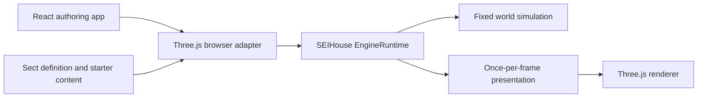

# Runtime 0.1 foundation

`src/engine` is the reusable, browser-independent part of the SEIHouse World Engine.
It imports neither React nor Three.js. A host supplies elapsed time, system
callbacks and a renderer; the runtime owns scheduling, clocks and teardown order.
The current host is `PocketWorldController`.



## Register systems

```ts
import { EngineRuntime } from './src/engine';

let position = 0;
const runtime = new EngineRuntime({
  systems: [
    {
      id: 'movement',
      fixedUpdate: ({ deltaSeconds }) => { position += 2 * deltaSeconds; },
    },
    {
      id: 'presentation',
      update: ({ alpha }) => { /* present the current world; alpha enables interpolation */ },
      dispose: () => { /* release resources owned by this system */ },
    },
  ],
});

runtime.advance(1 / 60); // the host converts its clock delta to seconds
runtime.pause();
runtime.advance(3);      // clocks remain frozen; frame callbacks receive deltaSeconds=0
runtime.resume();
runtime.advance(1 / 60);
const snapshot = runtime.diagnostics();
runtime.dispose();
```

Registration order defines fixed-update and frame-update order. All fixed steps
run before the once-per-frame callbacks. IDs must be unique and nonempty, and
registration is captured at construction. A system may own only one phase or both.
A future engine feature registers a participant at the host's composition point;
it does not need a new independent animation loop.

## Time and limits

| Setting or clock | Current behavior |
| --- | --- |
| Fixed simulation step | 1/60 second by default |
| Maximum accepted frame delta | 0.25 second by default |
| Catch-up limit | At most 8 fixed steps per host frame |
| Simulation elapsed | Fixed tick count multiplied by the fixed step |
| Presentation elapsed | Accepted active host time; distinct from simulation elapsed when work is dropped |
| `alpha` | Fractional progress toward the next fixed tick; current inhabitants do not yet interpolate with it |
| Paused behavior | Both clocks freeze; frame callbacks still run with zero delta |
| `droppedSeconds` | Reports frame time rejected by the clamp plus fixed backlog discarded by the catch-up limit |

This bounds work after a long frame. It deliberately sacrifices elapsed simulation
time rather than letting a stalled tab create unlimited catch-up work. A stable
fixed rate is a foundation for reproducibility, not a claim of deterministic
replay: existing world systems still use global randomness and timestamp IDs.

The browser host resets its frame timestamp on pause, resume and visibility
changes. Hidden documents pause automatically. Explicitly paused worlds stay
paused after the document becomes visible. Tours use the runtime's active
presentation clock and therefore do not skip ahead while paused. At ordinary
frame rates, their duration remains 30 active seconds.

## Current world integration

Fixed simulation preserves the relative clock/terrain/inhabitant/creature/weather/
effect update order. Camera, palette fades, lighting, object animation and rendering
run once per presentation frame. Tour choreography now runs in presentation; its
spawns and time-of-day changes reach simulation on the next fixed step.

`PocketWorldController.getEngineDiagnostics()` returns a detached snapshot with
engine identity, world ID, runtime counters, renderer geometry/texture counts and
population. These are local diagnostics, not remote telemetry. No new controls or
debug panels are added to the player UI.

## Lifecycle and resource ownership

`pause()` preserves the scene; `dispose()` ends its lifetime. Disposal stops browser
scheduling, removes the visibility listener, unbinds input, releases scene
resources, and disposes the renderer. Repeated disposal is safe. Other controller
mutations reject use after disposal.

Runtime systems dispose in reverse registration order, and every disposer is
attempted even if a peer fails. Failures are reported together as an `AggregateError`.
Core runtime methods reject updates after disposal; diagnostics remain readable.

`releaseObjectResources(root)` releases geometry/material/shadow resources for an
owned removed subtree, deduplicating resources shared within that subtree. It
retains textures because effects can share a sprite with the sky. Current entity
builders allocate geometry/materials per entity; future sharing across owners
requires reference-counted asset ownership.

`disposeSceneResources(scene)` releases the entire world's resources, including
textures, and clears the scene. It supports `retainTextures` for textures owned by
an external cache or another world. Existing sky and environment textures are
created per world. The host releases scene resources before renderer disposal.
